<p align="center">
  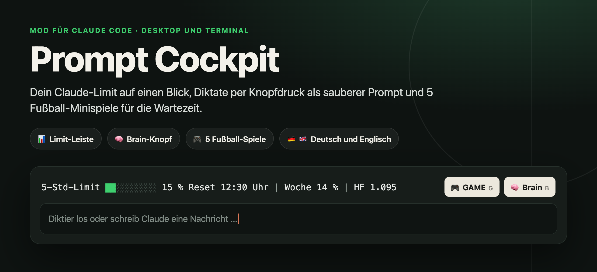
</p>

<p align="center">
  <b>Deutsch</b> · <a href="#english">English</a>
</p>

<p align="center">
  
  
  
</p>

Prompt Cockpit setzt eine Leiste über das Eingabefeld von Claude. Links siehst du, wie viel von deinem 5-Stunden-Limit und vom Wochenlimit schon weg ist. Rechts sitzen zwei Knöpfe: **🧠 Brain** macht aus einem wirren Diktat einen sauberen Prompt, **🎮 GAME** startet ein Fußball-Minispiel, während Claude arbeitet.

## Installieren in 1 Minute

### In der Claude-App (Desktop)

1. Klick im Eingabefeld auf **+** und dann auf **Plugins**.
2. Wähl **Add marketplace** und trag ein:
   ```
   djkimbo/prompt-cockpit
   ```
3. Unter **Add plugin** `prompt-cockpit` auswählen.
4. Neue Sitzung öffnen. Die Leiste steht über dem Eingabefeld.

### Im Terminal (Claude Code)

1. In Claude Code eintippen:
   ```
   /plugin install prompt-cockpit --marketplace djkimbo/prompt-cockpit
   ```
2. `Add marketplace?` mit `y` beantworten, dann den Bereich `user` mit Enter wählen.
3. Neue Sitzung starten.

Lieber direkt aus der Shell:

```bash
claude plugin install prompt-cockpit --marketplace djkimbo/prompt-cockpit
```

`prompt-cockpit` holt die drei Mods `limit-band`, `brain` und `game` automatisch mit. Du willst nur einen Teil? Dann installier einzeln `limit-band`, `brain` oder `game`. `game` bringt `brain` mit, weil der GAME-Knopf neben dem Brain-Knopf sitzt.

## Die Leiste, Stück für Stück

| Teil | Was er dir sagt |
|---|---|
| `5-Std-Limit ██░░░░░░░░ 15 %` | Verbrauch im laufenden 5-Stunden-Fenster als Balken aus 10 Kästchen. Ab 70 % wird er gelb, ab 90 % rot. |
| `Reset 12:30 Uhr` | Wann das 5-Stunden-Fenster neu startet. Läuft gerade keins, steht dort 0 % ohne Uhrzeit. |
| `Woche 14 %` | Dein Wochenlimit. |
| `HF 1.095` | Higgsfield-Credits. Erscheint nur, wenn du Higgsfield in Claude verbunden hast. |
| `🎮 GAME` (Taste `G`) | Öffnet ein Fußball-Minispiel im Browser, bei jedem Klick das nächste. |
| `🧠 Brain` (Taste `B`) | Räumt den Text im Eingabefeld auf und baut daraus einen gegliederten Prompt. |
| `↩ Rückgängig` | Erscheint nach Brain und holt deinen Originaltext zurück. |

Die Tasten `G` und `B` gelten im Terminal: erst mit `Ctrl+X` `Tab` die Leiste wählen, dann die Taste drücken. In der App reicht ein Klick.

## 🧠 Brain: Diktat rein, Prompt raus

<p align="center">
  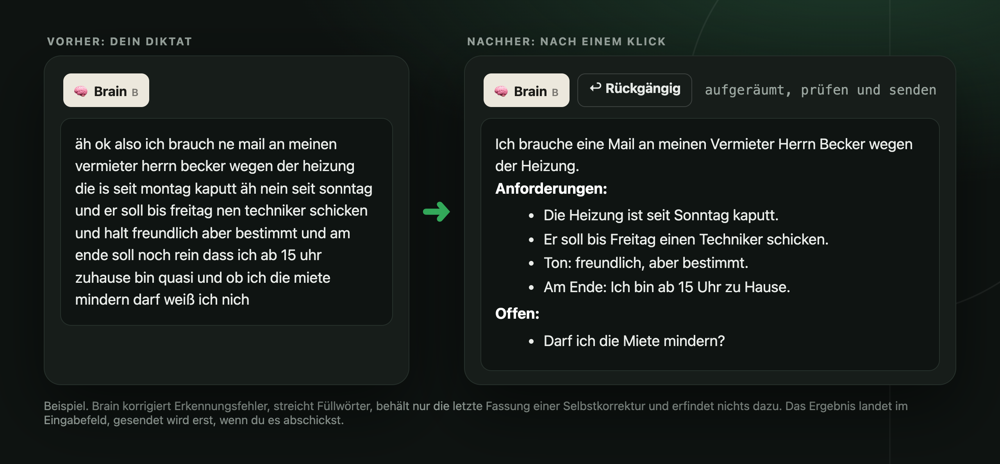
</p>

1. Diktier oder tipp deine Gedanken ins Eingabefeld, so wirr wie sie kommen.
2. Klick **🧠 Brain**.
3. Lies das Ergebnis und schick es ab. Passt es nicht, holt **↩ Rückgängig** dein Original zurück.

Brain korrigiert Erkennungsfehler und streicht Füllwörter wie „äh“, „halt“ oder „quasi“. Bei Selbstkorrekturen bleibt die letzte Fassung. Namen, Zahlen und Wünsche bleiben drin, dazu erfindet Brain nichts. Kurze Diktate unter 40 Wörtern mit einem einzigen Anliegen bleiben Fließtext. Als Befehl geht es auch: `/brain` räumt das Eingabefeld auf, `/brain dein Text` den Text dahinter.

## 🎮 Die 5 Spiele

Jedes Spiel ist eine einzelne HTML-Datei und läuft ohne Internet. Highscores speichert dein Browser. Die Texte gibt es auf Deutsch und Englisch.

<table>
  <tr>
    <td width="33%" valign="top">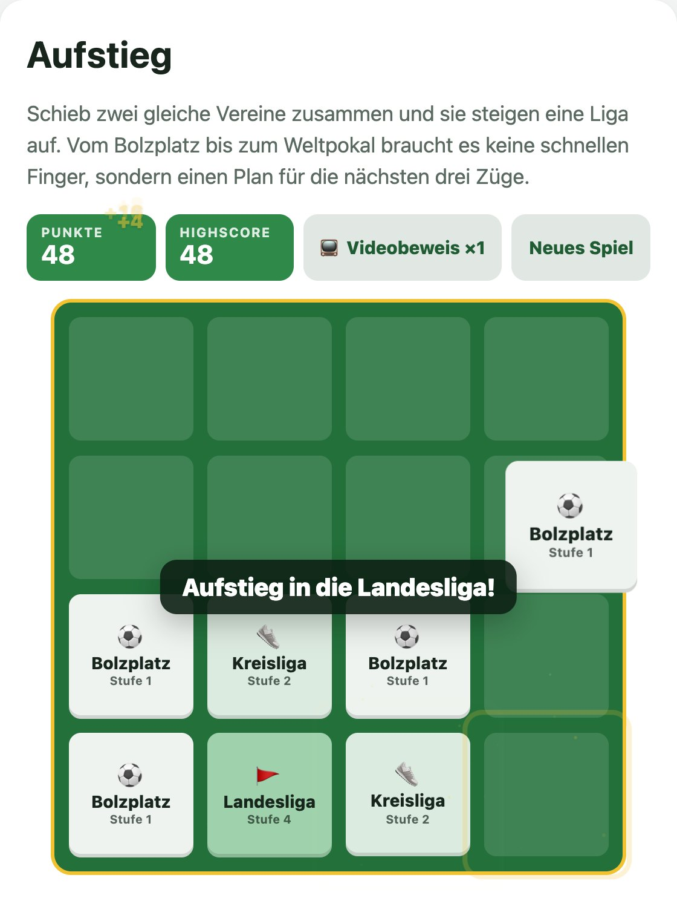<br><b>Aufstieg</b><br>Schieb zwei gleiche Vereine zusammen, dann steigen sie eine Liga auf. Vom Bolzplatz bis zum Weltpokal.</td>
    <td width="33%" valign="top">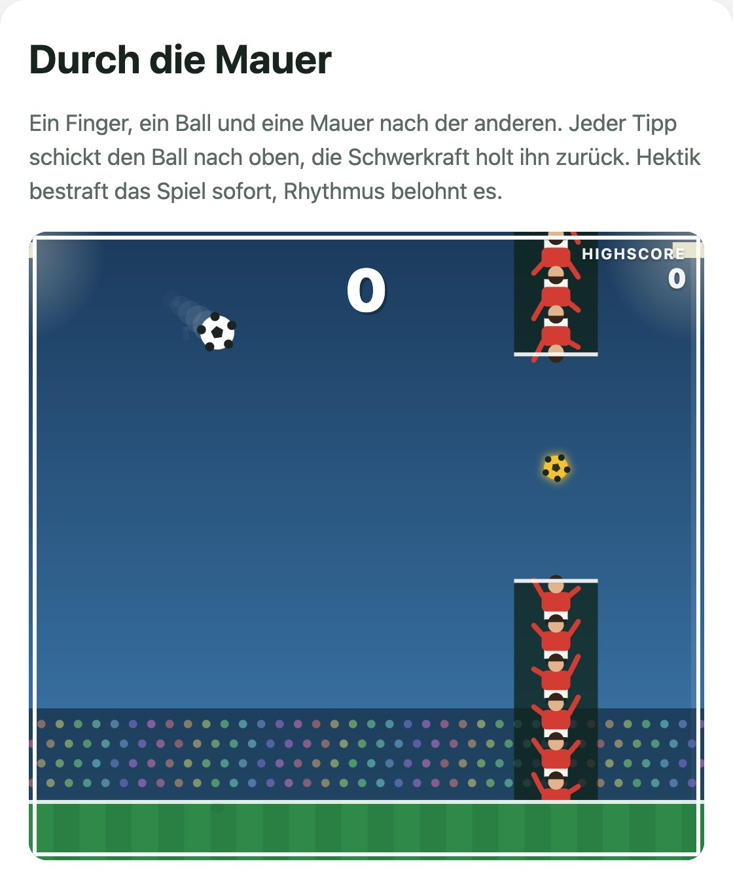<br><b>Durch die Mauer</b><br>Jeder Tipp schickt den Ball nach oben, durch die Lücken der Verteidiger-Mauern. Medaillen ab 10 Punkten.</td>
    <td width="33%" valign="top">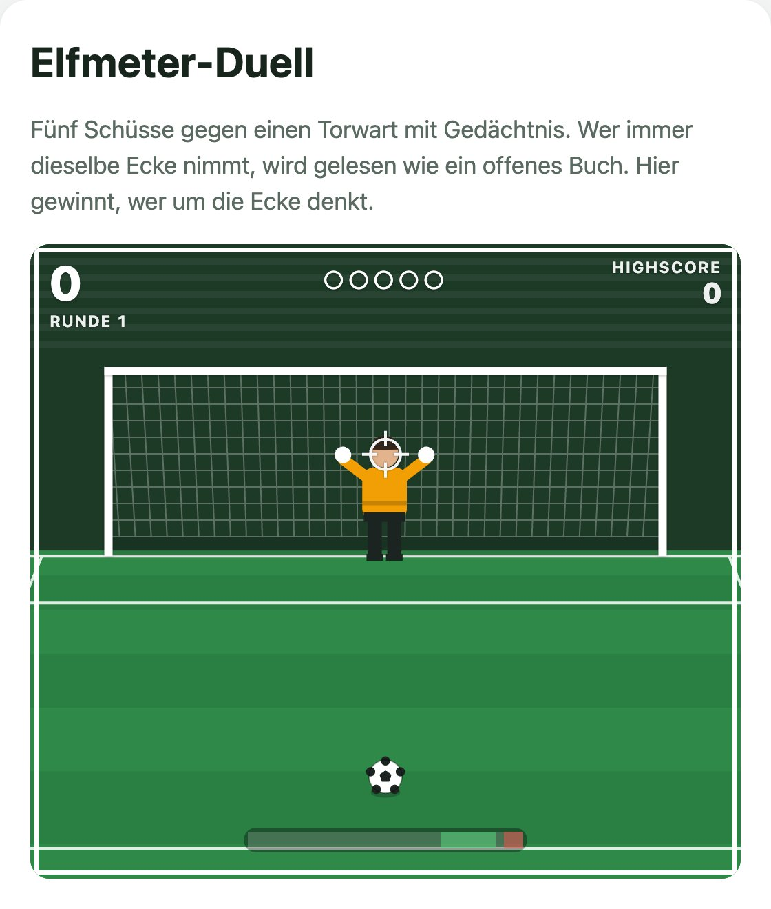<br><b>Elfmeter-Duell</b><br>5 Schüsse gegen einen Torwart, der sich deine Ecken merkt. Ab 3 Toren geht es in die nächste Runde.</td>
  </tr>
  <tr>
    <td width="33%" valign="top">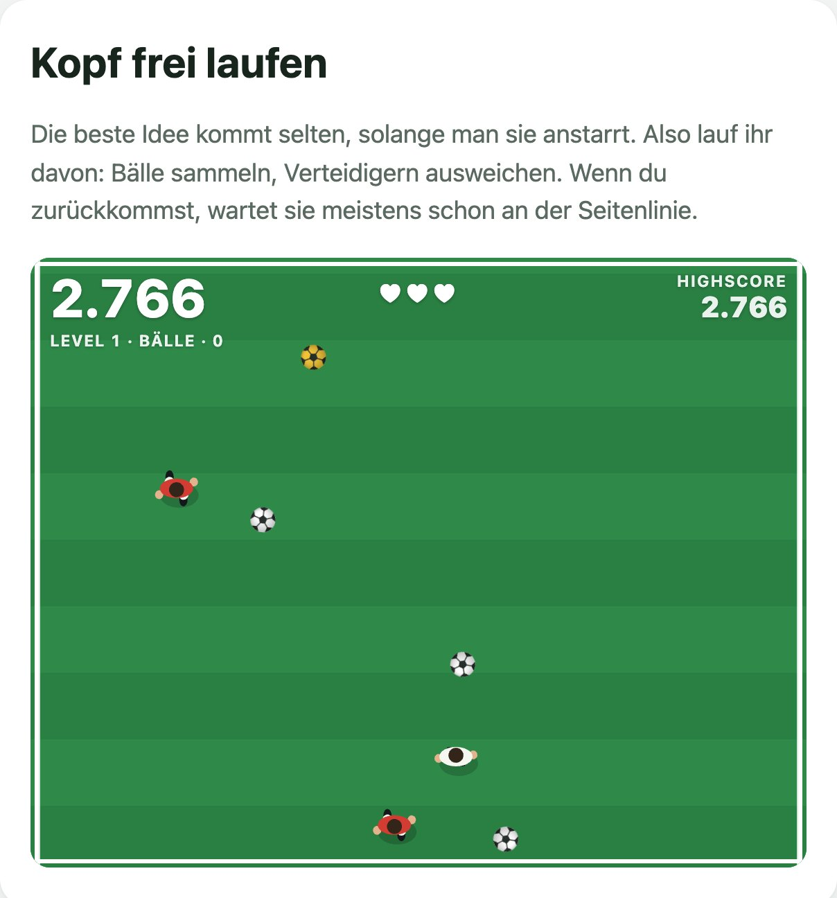<br><b>Kopf frei laufen</b><br>Bälle sammeln, Verteidigern ausweichen. Steuerung mit Pfeiltasten oder WASD.</td>
    <td width="33%" valign="top">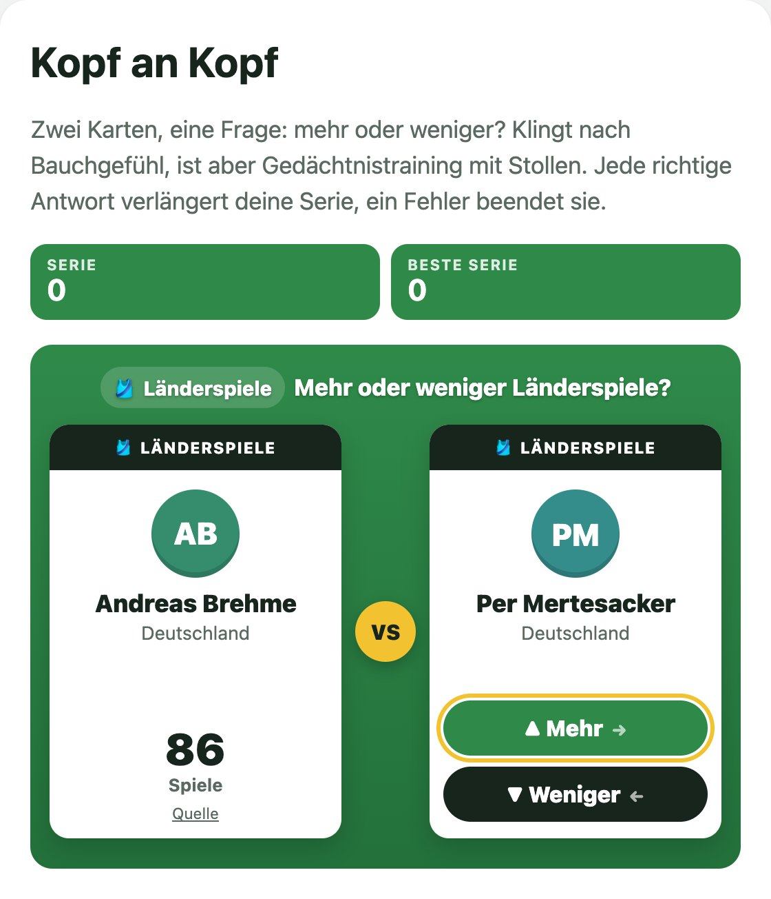<br><b>Kopf an Kopf</b><br>Zwei Karten, eine Frage: mehr oder weniger? Echte Zahlen zu Spielern und Vereinen, jede mit Quelle.</td>
    <td width="33%" valign="top"></td>
  </tr>
</table>

## Gut zu wissen

- **Limits:** Die Werte meldet Claude bei Anmeldung mit einem Claude-Abo. Ohne gemeldete Werte bleibt der Limit-Teil leer.
- **Brain kostet Nutzung:** Brain nutzt Claude Sonnet über dein eigenes Konto. Jeder Klick zählt zu deinem Verbrauch.
- **Higgsfield:** Der Mod erkennt einen verbundenen Higgsfield-Konnektor selbst. Den Stand fragt er beim Sitzungsstart und nach jedem Aufruf ab, der Credits verbraucht.
- **Sprache:** Folgt der Systemsprache. Deutsch auf deutschen Systemen, sonst Englisch. Erzwingen kannst du sie in `~/.claude/settings.json` mit `"env": { "PROMPT_COCKPIT_LANG": "de" }` (oder `"en"`).
- **Getestet** mit Claude Code 2.1.326 auf macOS.

## Deine Daten

- **Brain** schickt den Text aus dem Eingabefeld an Claude, über dein Konto, wie eine normale Nachricht.
- **limit-band** fragt bei Higgsfield nur den Kontostand ab, über deinen eigenen Konnektor.
- **Die Spiele** laden nichts nach und senden nichts. In „Kopf an Kopf“ öffnen die Quellen-Links eine Seite, und nur, wenn du sie anklickst.

## Entfernen

```bash
claude plugin uninstall prompt-cockpit
claude plugin uninstall limit-band
claude plugin uninstall brain
claude plugin uninstall game
```

## Lizenz

MIT, siehe [LICENSE](LICENSE). Prompt Cockpit ist ein privates Projekt von Kemal Duran und kein Produkt von Anthropic.

---

<a id="english"></a>

<p align="center">
  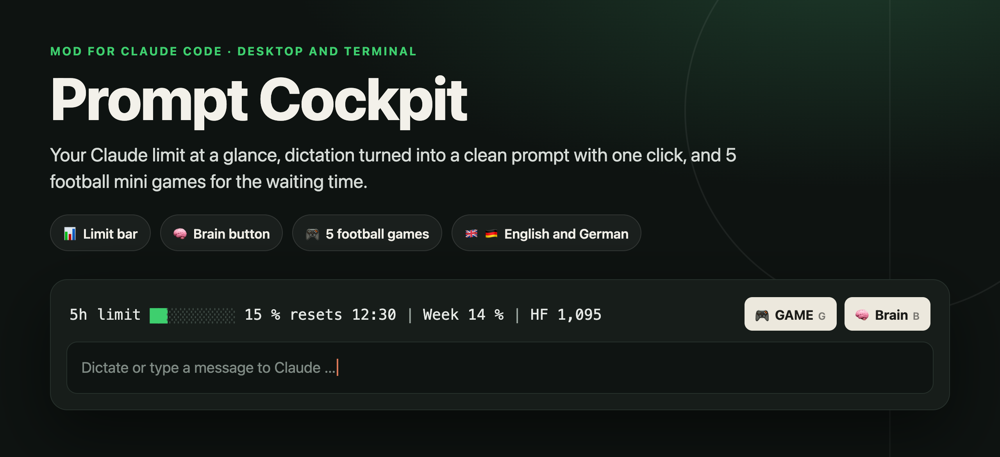
</p>

<p align="center">
  <a href="#">Deutsch</a> · <b>English</b>
</p>

Prompt Cockpit puts a bar above the Claude prompt. On the left you see how much of your 5-hour limit and your weekly limit is gone. On the right sit two buttons: **🧠 Brain** turns a messy dictation into a clean prompt, **🎮 GAME** starts a football mini game while Claude works.

## Install in 1 minute

### In the Claude app (desktop)

1. Click **+** in the prompt box, then **Plugins**.
2. Choose **Add marketplace** and enter:
   ```
   djkimbo/prompt-cockpit
   ```
3. Under **Add plugin**, pick `prompt-cockpit`.
4. Open a new session. The bar sits above the prompt box.

### In the terminal (Claude Code)

1. Type in Claude Code:
   ```
   /plugin install prompt-cockpit --marketplace djkimbo/prompt-cockpit
   ```
2. Answer `Add marketplace?` with `y`, then pick the `user` scope with Enter.
3. Start a new session.

Straight from a shell:

```bash
claude plugin install prompt-cockpit --marketplace djkimbo/prompt-cockpit
```

`prompt-cockpit` pulls in the three mods `limit-band`, `brain` and `game` by itself. Only want part of it? Install `limit-band`, `brain` or `game` on their own. `game` brings `brain` along, because the GAME button sits next to the Brain button.

## The bar, piece by piece

| Part | What it tells you |
|---|---|
| `5h limit ██░░░░░░░░ 15 %` | Usage in the current 5-hour window as a bar of 10 cells. It turns yellow at 70 % and red at 90 %. |
| `resets 12:30` | When the 5-hour window starts over. With no window running, it shows 0 % and no time. |
| `Week 14 %` | Your weekly limit. |
| `HF 1,095` | Higgsfield credits. Only shows up if you connected Higgsfield in Claude. |
| `🎮 GAME` (key `G`) | Opens a football mini game in your browser, the next one on every click. |
| `🧠 Brain` (key `B`) | Cleans up the text in the prompt box and turns it into a structured prompt. |
| `↩ Undo` | Shows up after Brain and brings your original text back. |

The keys `G` and `B` work in the terminal: select the bar with `Ctrl+X` `Tab` first, then press the key. In the app, a click does it.

## 🧠 Brain: dictation in, prompt out

<p align="center">
  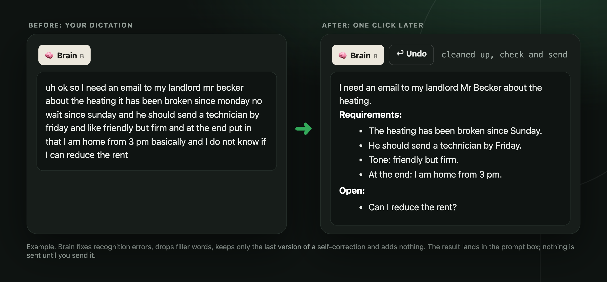
</p>

1. Dictate or type your thoughts into the prompt box, as messy as they come.
2. Click **🧠 Brain**.
3. Read the result and send it. If it's off, **↩ Undo** brings your original back.

Brain fixes recognition errors and drops filler words like "uh", "like" or "basically". With self-corrections, the last version stays. Names, numbers and requests stay in, and Brain adds nothing. Short dictations under 40 words with a single request stay plain text. It also works as a command: `/brain` cleans up the prompt box, `/brain your text` the text after it.

## 🎮 The 5 games

Each game is a single HTML file and runs offline. High scores stay in your browser. Texts come in English and German.

<table>
  <tr>
    <td width="33%" valign="top">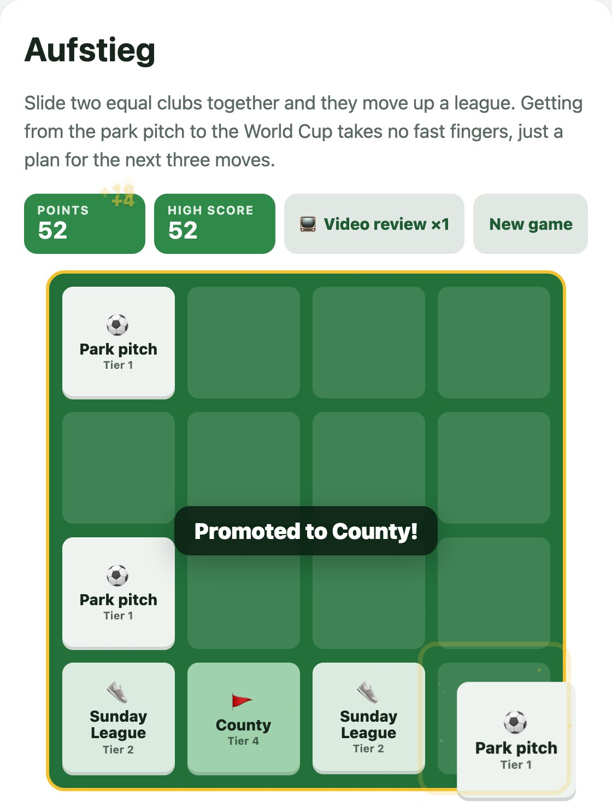<br><b>Aufstieg (Promotion)</b><br>Slide two equal clubs together and they move up a league. From the park pitch to the World Cup.</td>
    <td width="33%" valign="top">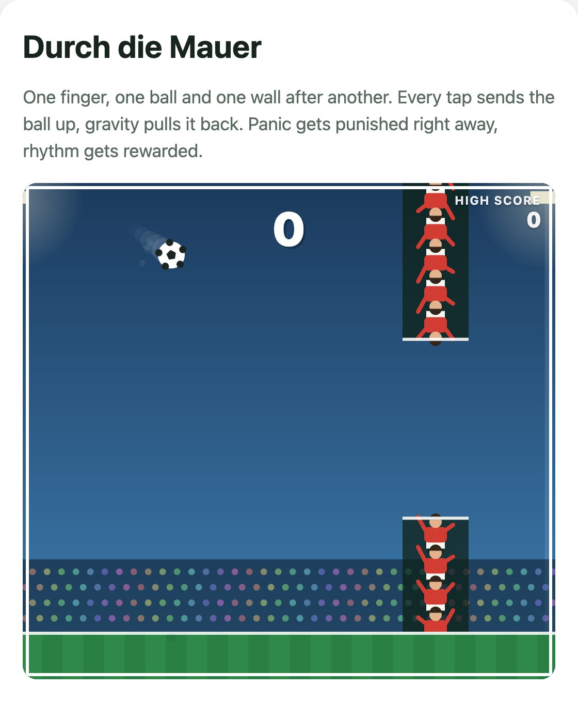<br><b>Durch die Mauer (Through the Wall)</b><br>Every tap sends the ball up, through the gaps in the defensive walls. Medals from 10 points.</td>
    <td width="33%" valign="top">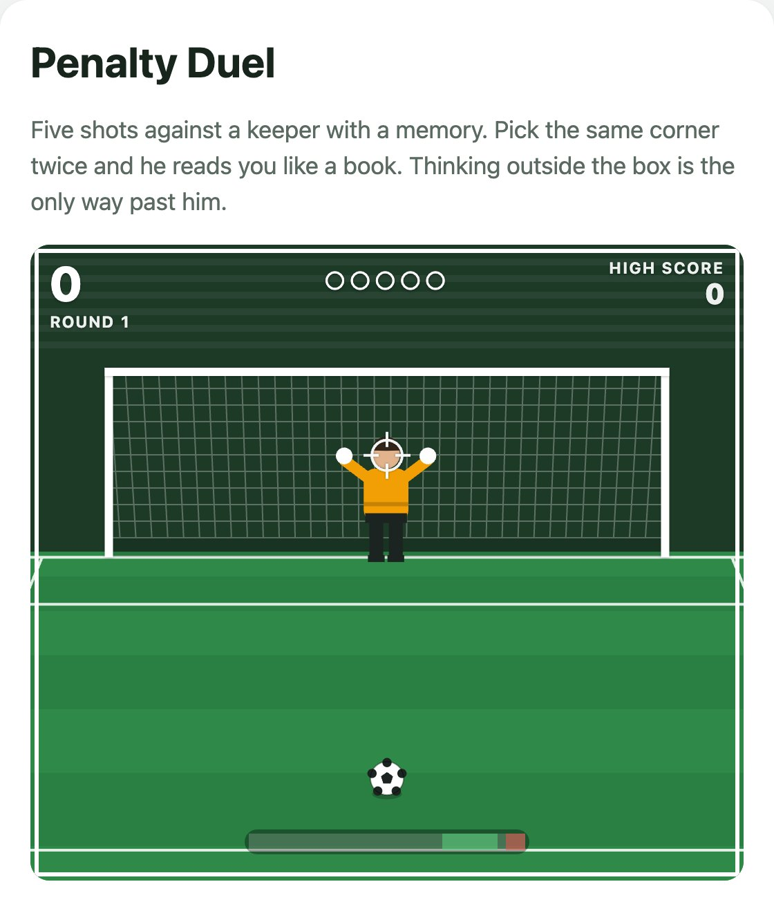<br><b>Penalty Duel</b><br>5 shots against a keeper who remembers your corners. Score 3 to reach the next round.</td>
  </tr>
  <tr>
    <td width="33%" valign="top">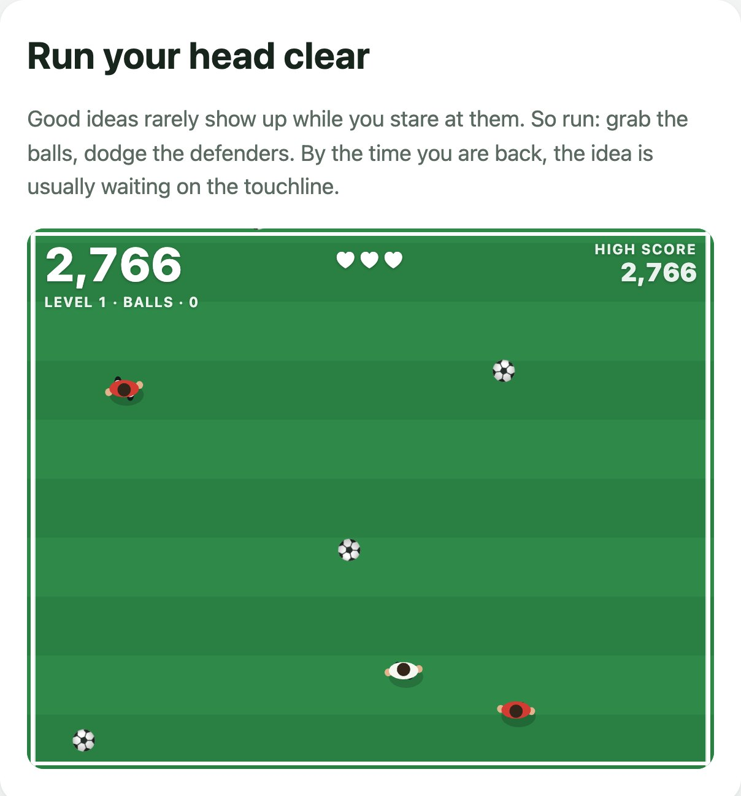<br><b>Run your head clear</b><br>Collect balls, dodge defenders. Arrow keys or WASD.</td>
    <td width="33%" valign="top">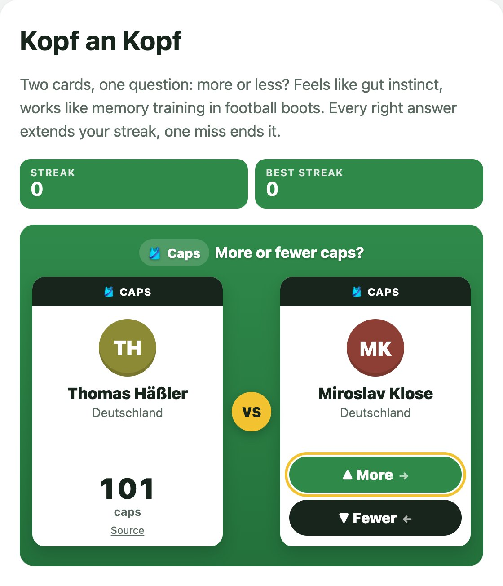<br><b>Kopf an Kopf (Head to Head)</b><br>Two cards, one question: more or less? Real numbers about players and clubs, each with a source.</td>
    <td width="33%" valign="top"></td>
  </tr>
</table>

## Good to know

- **Limits:** Claude reports these values when you sign in with a Claude subscription. Without reported values the limit part stays empty.
- **Brain uses your quota:** Brain runs Claude Sonnet through your own account. Every click counts towards your usage.
- **Higgsfield:** The mod finds a connected Higgsfield connector by itself. It checks the balance at session start and after every call that spends credits.
- **Language:** Follows your system language. German on German systems, English everywhere else. To force one, add `"env": { "PROMPT_COCKPIT_LANG": "en" }` (or `"de"`) to `~/.claude/settings.json`.
- **Tested** with Claude Code 2.1.326 on macOS.

## Your data

- **Brain** sends the text from the prompt box to Claude, through your account, like a normal message.
- **limit-band** only asks Higgsfield for your balance, through your own connector.
- **The games** load nothing and send nothing. In "Kopf an Kopf", the source links open a page, and only when you click them.

## Remove

```bash
claude plugin uninstall prompt-cockpit
claude plugin uninstall limit-band
claude plugin uninstall brain
claude plugin uninstall game
```

## License

MIT, see [LICENSE](LICENSE). Prompt Cockpit is a private project by Kemal Duran and not a product of Anthropic.
